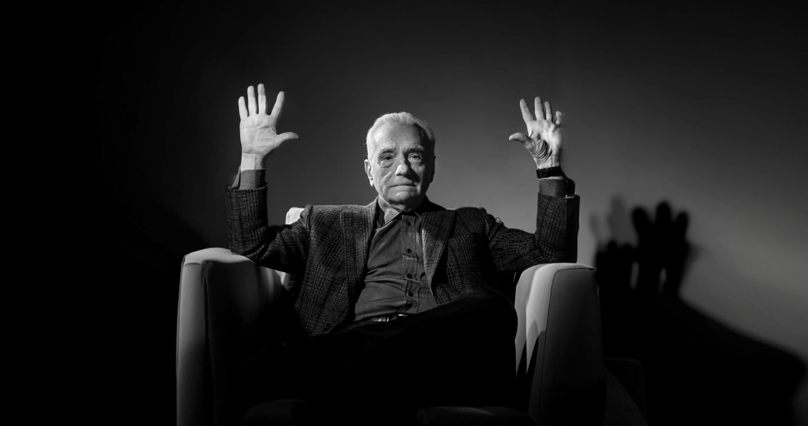

# Лабораторная работа №1

### **ФИО:** Конкин Александр Александрович
### **Группа:** 6402-010302D
### **Научный руководитель:** Минаев Евгений Юрьевич
### **Тема диплома:** Разарботка метода одновременной локализации и построения карты с использованием нейросетевых алгоритмов реконструкции сцены
> ### "Absolute cinema"
>
> #### — *Мартин Скорсезе*

# Лабораторная работа №2

**Тема:** «Chronos Tours» — сайт туристического агентства путешествий во времени.

**Страницы** (папка `lab2/`):
- `index.html` — главная: приветствие, цитата Рэя Брэдбери, карточки преимуществ;
- `tours.html` — каталог эпох: таблица маршрутов с уровнем риска и стоимостью;
- `safety.html` — памятка хрононавта: изображение, правила безопасности, контакты.

**HTML:** блочные (`header`, `main`, `section`, `blockquote`, `table`) и строчные (`em`, `strong`, `span`, `small`, `cite`) элементы, ссылки (меню, `mailto:`, `tel:`), изображение, таблица.

**CSS** (отдельный файл `style.css`):
- селекторы: по тегу (`body`, `h1`, `p`), по классу (`.tour-table`, `.risk-badge`, `.warning-box`), по ID (`#main-terminal`, `#timeline-nav`), псевдокласс (`.nav-link:hover`);
- выравнивание в таблице: по левому краю, по центру и по правому краю;
- тёмная палитра с янтарным акцентом;
- без испольхования сторонних библиотек.

# Лабораторная работа №3

**Тема:** «Core JavaScript» — набор функций на чистом JavaScript, решения проверяются автоматическими тестами.

**Файлы** (папка `lab3/`):
- `src/core.js` — решения десяти заданий;
- `src/core.spec.js` — тесты на `mocha` (`assert`);
- `package.json` — скрипты `test`, `prettier`, `prettier:check`; зависимости `mocha`, `prettier`, `lint-staged`.

**Задания:**
- `isInteger` — проверка на целое число через побитовые операторы;
- `even` — массив чётных чисел от 2 до 20;
- `sumTo` / `recSumTo` — сумма чисел до `n` циклом и рекурсией;
- `factorial` — факториал `n`;
- `isBinary` — проверка, что число является степенью двойки (`n & (n - 1)`);
- `fibonacci` — `n`-е число Фибоначчи без рекурсии;
- `getOperationFn` — замыкание: хранит значение и применяет к нему переданную операцию при каждом вызове;
- `sequence` — генератор арифметической последовательности с независимым состоянием у каждого экземпляра;
- `deepEqual` — рекурсивное сравнение объектов по содержимому.

# Лабораторная работа №4

**Тема:** «Chronos Tours» — модернизация сайта из ЛР2: современный CSS и ООП на JavaScript.

**Страницы и файлы** (папка `lab4/`):
- `index.html` — главная: вёрстка на **Flexbox** (шапка, меню, блок с текстом и порталом, карточки), CSS-анимация портала;
- `tours.html` — каталог эпох (таблица из ЛР2);
- `safety.html` — памятка хрононавта: вёрстка на **Grid** (области `suit`, `rules`, `contacts`, на узких экранах — в одну колонку);
- `booking.html` — форма бронирования: текстовое поле, email, список, радиокнопки, textarea, чекбокс согласия и кнопка отправки;
- `style.css` — единый файл стилей;
- `script.js` — класс `Booking` и обработчик отправки формы.

**CSS:**
- все цвета заданы только через переменные в `:root` (`--color-bg`, `--color-accent` и т. д.);
- анимация «временной портал»: три вращающихся кольца и светящееся ядро (`@keyframes portal-spin`);
- бонус: классы названы по методологии **БЭМ** (`block__element--modifier`), например `nav__link--active`, `badge--high`, `form__input`.

**JavaScript:**
- класс `Booking` с конструктором (имя, почта, эпоха, страховка, пожелания, согласие) и методом `print()`, который форматированно выводит данные в консоль;
- при отправке формы отменяется перезагрузка страницы, создаётся объект `Booking` из введённых данных и вызывается `print()`. Результат смотреть в консоли браузера (F12).
